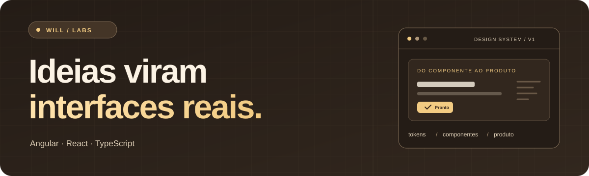
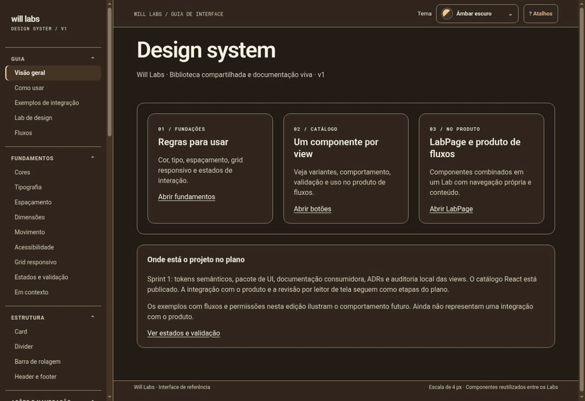

  

<h1 align="center">Will Oliveira</h1>

<strong>Desenvolvedor Frontend Pleno · Angular · React · TypeScript</strong>

  Transformo regras complexas em interfaces claras, com atenção ao comportamento do produto e à manutenção do código.

  <a href="https://www.linkedin.com/in/wildemberg-de-jesus-oliveira/">LinkedIn</a>
  ·
  <a href="https://github.com/Will-Ifes?tab=repositories">Repositórios</a>

---

## Will Labs

  
   
  Prévia animada do site publicado · clique para experimentar

Design system em React, com tokens compartilhados, oito temas e componentes reutilizáveis. Um espaço para explorar interfaces, decisões de arquitetura e testes.

**Explore:** [site](https://will-ifes.github.io/will-labs/) · [código](https://github.com/Will-Ifes/will-labs) · [arquitetura](https://github.com/Will-Ifes/will-labs/tree/main/docs/adr) · [testes](https://github.com/Will-Ifes/will-labs/tree/main/tests)

## Projetos em destaque

| Projeto | O que você pode explorar | Código |
| --- | --- | --- |
| **WERT** | Interface e API de gestão: usuários, produtos e movimentações de estoque. | [Frontend](https://github.com/Will-Ifes/wert-frontend) · [Backend](https://github.com/Will-Ifes/wert-backend) |
| **Trello.ia** | Autenticação, recuperação de senha e base de dashboard de um projeto pessoal. | [Frontend](https://github.com/Will-Ifes/trello-ia-frontend) · [Backend](https://github.com/Will-Ifes/trello-ia-backend) |

**Veja as decisões no código:** [componentes e tokens do Will Labs](https://github.com/Will-Ifes/will-labs/tree/main/packages) · [operações de estoque no WERT](https://github.com/Will-Ifes/wert-backend/tree/main/src/domain/stockManagement) · [testes de autenticação no Trello.ia](https://github.com/Will-Ifes/trello-ia-frontend/tree/main/src/features/auth/__tests__)

Os READMEs apresentam o contexto, a implementação e o estágio de cada projeto.

## Como trabalho

- Transformo regras de produto em fluxos e interfaces compreensíveis.
- Construo componentes reutilizáveis e integrações previsíveis.
- Cuido dos estados da interface, da responsividade e da acessibilidade.

  

**Foco:** Angular, React e TypeScript.  
**Também utilizo:** Next.js, RxJS, Tailwind CSS, Node.js, NestJS, Prisma e PostgreSQL.

---

  <strong>Vamos conversar sobre frontend e produtos?</strong> 
  <a href="https://www.linkedin.com/in/wildemberg-de-jesus-oliveira/">Fale comigo pelo LinkedIn</a>

